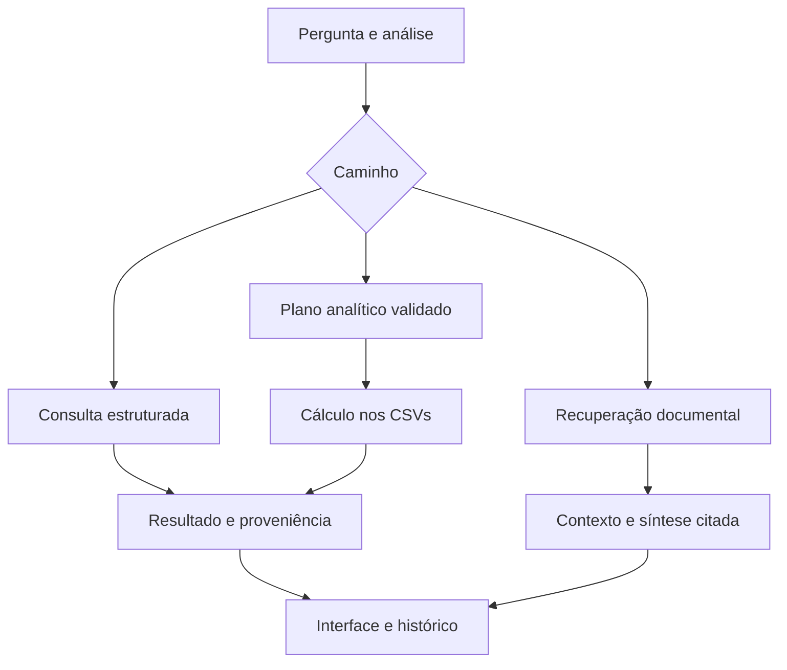

# Arquitetura do Sistema

## Implementação publicada — revisão de 21/10/2026

A revisão adiciona planejamento analítico, cálculo nos arquivos completos,
síntese explicativa citada e combinação de resultados e documentos.
Publicação confirmada pelo [PR #52](https://github.com/rag-grande-desafio-grupo1-cenario-1/repositorio1/pull/52), integrado à `main` no commit `2365d6bb01e937bc02a3e55a2c034eca362a9fe6`. O commit das correções é `f3e25d01a8a6fe0c5aac33a86c338346696830cb`.
A tag `entrega-2026-10-19` preserva a versão anterior.

A consulta combinada apresenta cálculo e explicação documental em partes
identificadas, com suas fontes. Esclarecimentos e recusas podem encerrar
o caminho antes da execução correspondente.

### Componentes atuais

| Componente | Papel |
|---|---|
| `app/pipeline_adapter.py` | Integra os caminhos existentes e o despacho analítico |
| `app/analytical_dispatch.py` | Seleciona o caminho analítico habilitado e aplicável |
| `src/analytical_interpreter.py` e `analytical_transport.py` | Interpretam a pergunta e validam a proposta |
| `src/analytical_plan.py` | Define fontes, campos, operações e consistência |
| `src/analytical_sources.py` e `analytical_executor.py` | Leem CSVs autorizados e calculam com Decimal |
| `src/analytical_capabilities.py` | Protege condições conhecidas ausentes |
| `src/query_decomposition.py` | Separa pedidos analíticos e documentais reconhecidos |
| `app/analytical_adapter.py` e `analytical_combined.py` | Preparam e combinam resultados |
| `src/analytical_presentation.py` | Apresenta agrupamentos sem recalcular valores |
| `src/context_focus.py`, `context_budget.py` e `document_context.py` | Preparam contexto sem alterar os artefatos |
| `src/grounded_synthesis.py` e `generate.py` | Produzem síntese e validam o contrato das citações |
| `app/history_store.py` e `feedback_store.py` | Persistem consultas e feedback |

O caminho analítico exige `RAG_ANALYTICAL_ENABLED=true` e utiliza os CSVs
do PE e do PCA. A base estruturada PNCP mantém seu executor.
A integração atual executa o caminho anterior antes do despacho analítico,
podendo produzir etapas adicionais e aumentar a latência.

A recuperação documental combina busca vetorial, BM25 e RRF.
O rerank é opcional e permanece desativado nas validações atuais.
A síntese explicativa é o padrão; o modo extrativo exige ativação explícita.

### Logs e validação

O planejamento analítico utiliza `roteamento` com tipo de evento específico.
Os cálculos são registrados em `consulta_agregada`.
Consultas combinadas referenciam os identificadores próprios da execução
documental no resultado principal.

A validação verifica contratos, consistência e referências.
Não garante automaticamente a interpretação de toda condição da pergunta
nem o suporte semântico de cada afirmação.

O histórico reapresenta o resultado original sem executar novamente o pipeline.
Histórico e feedback possuem persistência separada.

Consulte o [relatório atual](docs/CORRECOES_RESPOSTAS_2026-10-21.md)
e o [README](README.md) para configuração, evidências e limitações.

## Planejamento inicial preservado

**As seções abaixo são históricas.** Fontes previstas, verbos no futuro,
diagrama e estágios descrevem o planejamento inicial. O estado atual está acima.

## 1. Cenário escolhido

**Cenário 1 — Contratações Públicas do Estado do Rio de Janeiro**

A equipe escolheu o cenário de contratações públicas por trabalhar com dados públicos provenientes de fontes oficiais e por permitir a integração de bases de naturezas diferentes. Além disso, o cenário apresenta consultas que exigem combinar busca semântica, filtros estruturados, documentos normativos e informações agregadas, sendo adequado para o desenvolvimento de um sistema baseado em Adaptive RAG.

---

## 2. Bases de conhecimento

O sistema utilizará quatro bases de naturezas diferentes, conforme definido para o cenário:

| Base | Conteúdo | Fonte principal | Tratamento esperado |
|---|---|---|---|
| **Normativa** | Lei nº 14.133/2021, decretos estaduais e editais de licitação | Planalto e arquivos de contratação do PNCP | Recuperação textual considerando estrutura e vigência dos documentos |
| **Estruturada** | Contratos e contratações públicas do RJ em período fechado | API de consulta do PNCP | Registros completos e filtros por metadados |
| **Conversacional** | Atas de registro de preços e comunicações sintéticas de compras | PNCP e base sintética | Recuperação textual com tratamento de dados pessoais |
| **Agregada** | Plano de Contratações Anual e valores homologados por item | PNCP | Consultas numéricas considerando o recorte utilizado |

O roteamento não será realizado apenas pelas palavras presentes na consulta. O sistema deverá identificar **qual tipo de evidência é necessário para responder à pergunta** e selecionar uma ou mais bases.

Como a API do PNCP não oferece busca textual por objeto, a coleta será realizada a partir de recortes determinísticos definidos para o corpus. A busca textual e semântica sobre os objetos das contratações será realizada localmente após a ingestão e a indexação.

---

## 3. Pipeline planejado

A arquitetura será organizada como um pipeline de Retrieval-Augmented Generation (RAG) adaptativo.

O fluxo principal será:

    Usuário
      |
      v
    query_analysis
      |
      v
    roteamento
      |
      +-------------------------------+
      |                               |
      v                               v
    retrieval_denso             retrieval_bm25
      |                               |
      +---------------+---------------+
                      |
                      v
                  fusao_rrf
                      |
                      v
                    rerank
                      |
                      v
                   geracao
                      |
                      v
                  validacao
                      |
                      v
                  feedback
                      |
                      v
               Resposta ao usuário

Os nomes utilizados no diagrama correspondem aos valores que serão utilizados no campo `stage` dos logs do pipeline.

---

## 4. Estágios da arquitetura

### `query_analysis`

Interpreta a pergunta antes da recuperação. Essa etapa deverá identificar o objetivo da consulta e extrair filtros quando existirem, como UF, período, modalidade, órgão, município, valores e número de controle PNCP.

### `roteamento`

Define qual ou quais bases contêm as evidências necessárias para responder à consulta. O roteador poderá selecionar uma única base ou múltiplas bases para perguntas do tipo cross-source.

### `retrieval_denso`

Realiza a recuperação semântica por embeddings. Será especialmente útil para consultas em que o usuário descreve o objeto da contratação sem utilizar exatamente os mesmos termos presentes nos documentos.

### `retrieval_bm25`

Realiza a recuperação lexical. Será utilizada principalmente para termos que exigem correspondência exata, como CNPJ, número de contrato, número de controle PNCP e outros identificadores.

### `fusao_rrf`

Combina os resultados da recuperação densa e da recuperação BM25 utilizando Reciprocal Rank Fusion (RRF).

### `rerank`

Reordena os documentos recuperados utilizando cross-encoder. O modelo de reranqueamento será incorporado quando o endpoint correspondente for disponibilizado no Sprint 2.

### `geracao`

Utiliza as evidências selecionadas para produzir a resposta. A geração deverá manter a rastreabilidade das fontes utilizadas e respeitar as regras de sensibilidade do cenário.

### `validacao`

Verifica a estrutura da resposta e aplica as regras de guardrails antes de apresentar o resultado ao usuário.

### `feedback`

Registra a avaliação do usuário e as informações necessárias para o histórico persistente do sistema.

---

## 5. Recuperação e Adaptive RAG

O sistema utilizará Adaptive RAG para decidir onde buscar antes de iniciar a recuperação. Uma consulta poderá utilizar uma ou várias bases dependendo do tipo de evidência necessária.

A recuperação combinará:

1. busca densa por embeddings;
2. busca lexical com BM25;
3. filtros por metadados;
4. fusão dos rankings com RRF;
5. reranqueamento com cross-encoder.

Filtros estruturados poderão ser aplicados sobre informações como UF, período, modalidade, órgão, município, situação da contratação e faixa de valores.

Essa combinação permite tratar consultas de naturezas diferentes. Por exemplo, uma busca por CNPJ pode depender principalmente do BM25, enquanto uma consulta como "aquisição de equipamentos hospitalares" pode depender da busca semântica. Consultas envolvendo valores, datas ou modalidades também poderão exigir filtros estruturados.

---

## 6. Ingestão, metadados e sensibilidade

O tratamento dos documentos será adaptado à natureza de cada base. Registros estruturados poderão ser tratados como unidades semânticas completas, enquanto documentos normativos poderão ser divididos de acordo com sua estrutura, preservando informações necessárias para identificação e vigência.

Todo chunk deverá possuir, no mínimo, os seguintes metadados:

- `source_file`;
- `doc_type`;
- `chunk_id`;
- `sensitivity`;
- `base_id`.

Outros metadados poderão ser acrescentados de acordo com a base, como órgão, modalidade, valor, município, ano, data de publicação, número de controle PNCP e campo de vigência.

A sensibilidade deverá ser classificada durante a ingestão.

No cenário de contratações públicas:

- **Responder:** valores de contratos, objeto contratado, nome de empresa fornecedora e CNPJ de pessoa jurídica;
- **Mascarar:** CPF de pessoa física, telefone pessoal e e-mail pessoal presentes nos documentos;
- **Recusar:** dados bancários, credenciais e solicitações que exijam juízo sobre fraude ou legalidade de uma contratação específica.

---

## 7. Observabilidade

Todo módulo deverá registrar sua execução em logs estruturados no formato JSONL:

`logs/pipeline-AAAA-MM-DD.jsonl`

Cada registro deverá conter, no mínimo:

- `ts`;
- `run_id`;
- `query_id`;
- `stage`;
- `status`;
- `latencia_ms`;
- `input`;
- `output`;
- `tokens`;
- `modelo`;
- `extra`.

O mesmo `run_id` deverá acompanhar todas as etapas pertencentes à mesma pergunta, permitindo identificar em qual ponto do pipeline ocorreu uma eventual falha.

Os nomes fixos de `stage` serão:

- `query_analysis`;
- `roteamento`;
- `retrieval_denso`;
- `retrieval_bm25`;
- `fusao_rrf`;
- `rerank`;
- `geracao`;
- `validacao`;
- `feedback`.

Nas etapas que utilizarem o LLM, os dados de uso deverão registrar `prompt_tokens`, `completion_tokens` e o total de tokens.

---

## 8. Cache e persistência

Como o endpoint de modelos é compartilhado pela turma, os embeddings deverão ser armazenados em cache desde o início do projeto.

Os índices serão persistidos em disco e recarregados nas execuções seguintes, evitando a reindexação completa do corpus. Quando aplicável, serão utilizados mecanismos equivalentes a `save_local` e `load_local`.

A geração de embeddings deverá ser realizada em lotes pequenos. A configuração inicial seguirá a recomendação de lote de 50 elementos e pausa de 10 segundos entre os lotes, podendo ser ajustada de forma controlada conforme os testes.

---

## 9. Testabilidade

Cada módulo deverá possuir testes em `tests/`, executáveis com `pytest`.

Serão consideradas três camadas:

| Camada | Objetivo | Dependência de LLM |
|---|---|---|
| **Unitário** | Testar funções determinísticas, serialização, normalização de filtros e cálculo do RRF | Não |
| **Contrato** | Validar metadados obrigatórios, schemas e regras da resposta estruturada | Não |
| **Integração** | Executar o pipeline de ponta a ponta com perguntas conhecidas | Sim |

Os testes que dependem do endpoint do LLM serão marcados separadamente, permitindo que os testes unitários e de contrato sejam executados offline.

---

## 10. Organização dos módulos

A arquitetura seguirá a estrutura de módulos prevista para o projeto:

| Módulo | Responsabilidade |
|---|---|
| `src/fetch_corpus.py` | Coleta, atualização, versionamento e inventário do corpus |
| `src/ingest.py` | Extração, chunking e metadados |
| `src/index.py` | Embeddings e índices por base |
| `src/router.py` | Query Analyzer e Adaptive RAG |
| `src/retrieve.py` | Recuperação densa, BM25, filtros, RRF e rerank |
| `src/generate.py` | Síntese da resposta e guardrails |
| `src/schema.py` | Modelos Pydantic e resposta estruturada |
| `src/obs.py` | Logging estruturado e contabilização de tokens |
| `app/` | Interface visual e integração do pipeline com o usuário |

---

## 11. Divisão de responsabilidades

A equipe adotou uma divisão de responsabilidades por módulos e etapas do pipeline. Cada integrante ficará responsável por acompanhar principalmente a implementação, os testes iniciais e a integração de sua parte, sem impedir a colaboração dos demais membros.

| Área/Módulo | Responsável | Responsabilidade principal |
|---|---|---|
| Coordenação da equipe | **Maria Eduarda** | Acompanhar tarefas, dependências, bloqueios, commits, documentação e integração entre os módulos |
| Coleta e versionamento — `fetch_corpus.py` | **Janice** | Coletar, versionar e organizar as quatro bases, além de atualizar o manifesto e o inventário |
| Ingestão — `ingest.py` | **Eridalgo** | Extrair o conteúdo, gerar chunks e incluir os metadados obrigatórios |
| Indexação — `index.py` | **Eridalgo** | Gerar embeddings, índice FAISS, índice BM25, cache e persistência dos índices |
| Roteamento — `router.py` | **Luiz Carlos** | Analisar as consultas, extrair filtros e decidir quais bases deverão ser consultadas |
| Recuperação — `retrieve.py` | **Luiz Carlos** | Executar recuperação densa, BM25, filtros e fusão RRF, retornando as evidências encontradas |
| Geração e guardrails — `generate.py` | **Felipe e Calvin** | Produzir respostas fundamentadas nas evidências e aplicar regras de segurança, sensibilidade e recusa |
| Schemas — `schema.py` | **Felipe e Calvin** | Definir e validar os contratos dos objetos utilizados na geração e na resposta estruturada |
| Observabilidade — `obs.py` | **Maria Eduarda** | Implementar e padronizar o logging estruturado, enquanto cada responsável integra os logs ao próprio módulo |
| Testes e avaliação | **Felipe e Calvin** | Criar testes unitários, de contrato e de integração, além de organizar os resultados em `eval/` |
| Interface e integração | **Maria Eduarda** | Desenvolver a interface, conectar o fluxo completo e apresentar respostas, fontes e evidências |
| Documentação | **Maria Eduarda, com contribuição da equipe** | Atualizar arquitetura, planejamento, dependências, decisões e orientações de execução |

A execução seguirá a dependência entre as etapas. A coleta libera a ingestão; a ingestão libera a indexação; os índices permitem validar a recuperação; a recuperação fornece evidências para a geração; e a geração libera a integração final com a interface.

Cada integrante também deverá atualizar seu arquivo individual em `acompanhamento/`, registrando sua participação, dificuldades, próximos passos e utilização de ferramentas de IA.

---

## 12. Fluxo resumido

**Usuário → `query_analysis` → `roteamento` → `retrieval_denso` + `retrieval_bm25` → `fusao_rrf` → `rerank` → `geracao` → `validacao` → `feedback` → Resposta**

Esta arquitetura representa o planejamento inicial do sistema e poderá ser refinada ao longo das próximas sprints conforme o corpus for consolidado, os módulos forem implementados e os testes evidenciarem necessidades de ajuste.

## Atualização do encaminhamento e da recuperação — 22/10/2026

O caminho analítico exige uma fonte reconhecida do catálogo; a presença
da rota agregada não basta para autorizar um arquivo específico.
A operação e a unidade do resultado são interpretadas separadamente
dos filtros. A listagem distinta remove combinações repetidas antes
do limite, preservando os cálculos independentes sobre o universo filtrado.

Referências explícitas de pregão limitam a associação documental.
Normas gerais permanecem elegíveis como fundamento. A busca contextual
usa stemming em português antes de remover os acentos.

Sem rerank aplicado, a cobertura dos métodos pode preservar candidatos
lexicais e densos quando o escopo documental resulta somente em normas.
Os scores originais são preservados. O orçamento normativo padrão passa
a 6.000 caracteres; a preparação de PDFs permanece independente.
