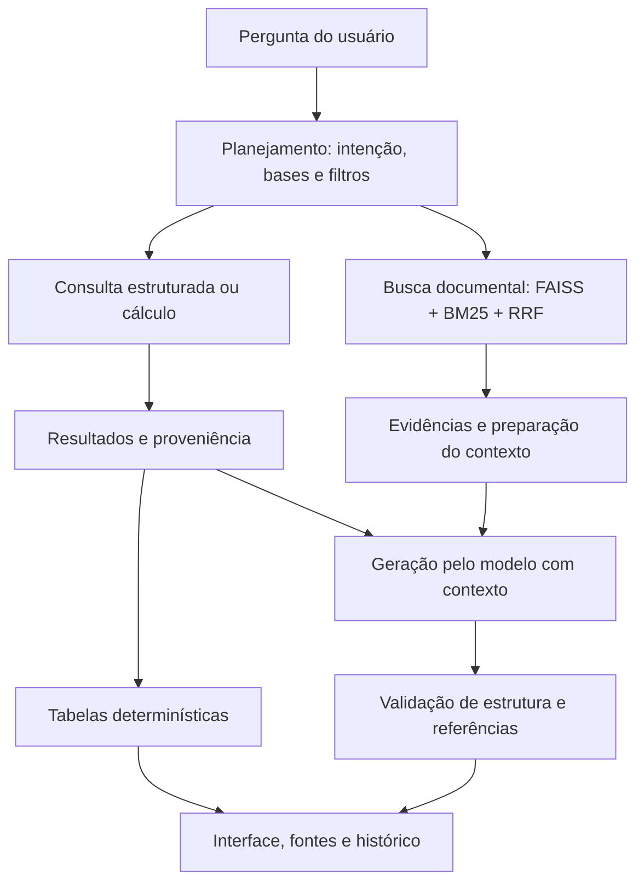

# Adaptive RAG para Contratações Públicas do RJ

**Grupo 1 · Cenário 1 · Grande Desafio de IA Generativa & RAG**

Residência TIC em Trilhas — PUC-Rio · Instituto ECOA

**Período:** 14/09/2026 a 23/10/2026
**Demo Day:** 23/10/2026

Consultas em linguagem natural que combinam cálculos sobre arquivos completos, recuperação documental e respostas com referências às fontes utilizadas.

[Materiais da entrega no Drive](https://drive.google.com/drive/folders/110gk1Q77490T6PJ_pYYsYL3L8iZ9xvsM?usp=sharing)

## Equipe

**Grupo 1 — Contratações Públicas do RJ**

- **Calvin Costa** — [@Calvin-Vinicius](https://github.com/Calvin-Vinicius)
- **Eridalgo Ramos** — [@EridalgoRamos](https://github.com/EridalgoRamos)
- **Felipe Teixeira** — [@Felipetds](https://github.com/Felipetds)
- **Janice Santos** — [@Janice977](https://github.com/Janice977)
- **Luiz Carlos** — [@luizcarlos001](https://github.com/luizcarlos001)
- **Maria Eduarda** — [@eduardaribs](https://github.com/eduardaribs)

## Cenário escolhido

**Cenário 1 — Contratações Públicas do Estado do Rio de Janeiro.**

Informações de contratação aparecem em registros do PNCP, planilhas, atas e legislação. Uma pergunta pode exigir contar registros, somar valores, identificar uma empresa ou explicar uma regra.

O objetivo foi reduzir a busca manual e permitir que o usuário confira os resultados nas fontes, apoiando equipes de compras, pesquisadores e profissionais de controle.

A aplicação consulta o corpus carregado. Ela não realiza uma consulta em tempo real a todo o PNCP e não cobre todas as contratações públicas.

## Dados utilizados

O pacote reúne **8 arquivos brutos e 2.172 chunks indexados**, distribuídos em quatro naturezas.

| Base | Conteúdo | Tratamento | Chunks |
| --- | --- | --- | ---: |
| Estruturada | 1.358 registros de contratações do PNCP no recorte associado ao RJ e à publicação em março de 2026 | Filtros, contagem e listagem na base normalizada | 1.358 |
| Normativa | Snapshot HTML da Lei nº 14.133/2021 | Recuperação de dispositivos e explicação com citações | 217 |
| Conversacional/documental | Três atas em PDF e uma comunicação sintética identificada como simulação | Recuperação textual e controles de dados pessoais | 78 |
| Agregada | PCA disponibilizado para o RJ em 2026 e itens do PE 038/26/2026 | Cálculos nos CSVs completos | 519 |
| **Total** | **JSON, CSV, PDF, HTML e TXT** | | **2.172** |

As atas foram organizadas na base conversacional/documental do projeto. A comunicação sintética é um material de teste, não um registro real.

### Recortes importantes

- **PNCP:** publicação entre 01/03/2026 e 31/03/2026, associada ao RJ. Ano da compra e ano da publicação são campos diferentes.
- **PCA:** 36.994 linhas. Ano e UF estão associados à origem do arquivo; não são filtros independentes por linha.
- **PE 038/26/2026:** 19 itens no arquivo de resultados.
- Os 519 chunks agregados não representam todas as linhas dos CSVs. Os cálculos suportados consultam os arquivos completos.
- Planejamento, homologação, entrega e pagamento representam situações diferentes.

Consulte o [manifesto do corpus](corpus_manifest.yaml) e a [arquitetura](ARQUITETURA.md).

## Arquitetura e funcionamento

O Adaptive RAG identifica qual tipo de evidência é necessário para responder à pergunta e seleciona o caminho correspondente.



O diagrama resume os caminhos funcionais. Na integração atual, o fluxo anterior pode executar etapas antes do despacho analítico, acrescentando trabalho e latência.

### Recuperação documental e geração

A busca vetorial encontra similaridade semântica, o BM25 contribui com correspondências lexicais e o RRF combina os rankings. Filtros e escopo ajudam a selecionar evidências pertinentes.

**A geração está implementada:** a pergunta e os trechos selecionados são enviados como contexto ao modelo, que produz a resposta com referências aos IDs fornecidos. A síntese explicativa é o padrão; existe também um modo extrativo para pedidos explícitos de apresentação de trechos.

A validação verifica estrutura e pertencimento das referências. Isso não garante automaticamente o suporte semântico de toda afirmação.

O controle **“Evidências para consultas documentais”**, de 1 a 5, tem padrão 3. Ele não determina três respostas ou três parágrafos e não limita os registros utilizados nos cálculos. A preparação do contexto pode reduzir o material efetivamente enviado.

### Consultas estruturadas e analíticas

A base normalizada do PNCP possui executor próprio para filtros, contagem e listagem.

O catálogo analítico utiliza os CSVs autorizados do PE 038/26/2026 e do PCA. O modelo interpreta o pedido e propõe um plano; o código valida campos e operações e executa os cálculos.

As operações incluem contagens, valores distintos, soma, média aritmética, mínimo, máximo, agrupamento, listagem, ordenação e comparações validadas. Os cálculos utilizam `Decimal`.

Resultados escalares ou mistos podem ser enviados ao gerador como contexto calculado. Quando todos os resultados são tabulares, o código pode apresentá-los diretamente, sem uma nova chamada de geração.

O evento `geracao` distingue a apresentação determinística em seus detalhes. Sua presença, sozinha, não comprova chamada ao modelo.

### Consultas combinadas

Pedidos reconhecidos com partes numéricas e documentais são separados. O resultado calculado e a explicação documental mantêm suas fontes e identificadores.

Um resultado calculado não é utilizado como evidência de uma regra jurídica.

### Rerank

O rerank local por cross-encoder foi implementado e avaliado, mas permaneceu **opcional e desativado na apresentação**.

A comparação registrada encontrou ganhos e perdas, sem melhoria consistente da cobertura das respostas no pequeno recorte avaliado.

- [Comparação de rankings](docs/comparacao_recuperacao_2026-10-19/RELATORIO.md)
- [Avaliação de respostas por método](docs/avaliacao_respostas_recuperacao_2026-10-19/RELATORIO.md)

Esses experimentos reutilizaram rankings preservados e não representam uma taxa geral de acerto do pipeline atual.

## Entregas concluídas

| Frente | Resultado |
| --- | --- |
| Corpus | Quatro bases organizadas, manifesto, hashes e pacote de dados |
| Preparação | Extração, chunks, metadados, embeddings e índices persistidos |
| Adaptive RAG | Planejamento e seleção de caminhos estruturados, analíticos, documentais ou combinados |
| Recuperação | Busca vetorial, BM25, RRF, escopo e preparação do contexto |
| Geração | Síntese com contexto e referências; modo extrativo disponível |
| Cálculos | Operações sobre arquivos completos, com filtros e proveniência |
| Interface | Consultas, plano, fontes, evidências e paginação quando aplicável |
| Persistência | Histórico SQLite e feedback JSONL vinculados às execuções |
| Observabilidade | Logs de consultas com etapas, identificadores, latência e tokens informados pelo serviço |
| Validação | Testes locais, compatibilidade dos artefatos e integração real |

O projeto foi apresentado no Demo Day de 23/10/2026. A entrega demonstra estratégias diferentes para necessidades diferentes, com resultados e fontes inspecionáveis.

O atendimento ao enunciado foi parcial em pontos de engenharia, detalhados nas limitações. A conclusão do período não significa ausência de pendências técnicas.

## Materiais da entrega

**[Abrir a pasta final do Grupo 1 no Google Drive](https://drive.google.com/drive/folders/110gk1Q77490T6PJ_pYYsYL3L8iZ9xvsM?usp=sharing)**

| Local | Conteúdo |
| --- | --- |
| `LEIA_PRIMEIRO.md` | Identificação e orientação geral |
| `apresentacao/` | Apresentação utilizada pela equipe |
| `dados_e_indices/data/` | Dados brutos, bases processadas, índices e cache |
| `execucao/` | Dependências e orientações |
| `documentacao/` | Cópias da documentação e evidências selecionadas |
| `MANIFESTO_SHA256.json` | Hashes e tamanhos dos arquivos registrados na organização da pasta |

O código-fonte e seu histórico permanecem neste repositório. Esta versão de portfólio é pública. O acesso ao pacote no Drive e ao serviço do modelo deve ser conferido separadamente.

Backups de desenvolvimento, credenciais, histórico de consultas e feedback não integram a pasta final. Cópias documentais no Drive podem anteceder atualizações posteriores no GitHub.

O manifesto deve ser atualizado quando novos arquivos forem adicionados à pasta.

## Como executar

O caminho principal abaixo utiliza **Google Colab**. Execute as células em ordem, na mesma sessão. Não utilize “Executar tudo” em notebooks antigos do desenvolvimento.

### Antes de começar

Você precisa de três acessos independentes:

| Recurso | O que é necessário |
| --- | --- |
| Código no GitHub | Acesso de leitura ao repositório, caso esteja privado |
| Dados no Google Drive | Acesso à pasta final da entrega |
| Serviço do modelo | Conexão com o endpoint utilizado pelo projeto e disponibilidade dos modelos |

**Um token do GitHub não é um requisito da aplicação.** Repositórios públicos podem ser clonados sem autenticação. Repositórios privados exigem permissão e algum método de autenticação, como token, SSH ou GitHub CLI.

Para o Colab, apresentamos a opção de guardar um token nos segredos do notebook. Cada pessoa deve utilizar sua própria credencial. O nome `GITHUB_TOKEN` é o nome escolhido para este exemplo.

A reprodução depende também da disponibilidade do serviço externo do modelo. Acesso ao código e aos dados, sozinho, não garante que esse serviço esteja disponível.

### 1. Criar uma sessão do Colab e obter o código

Abra um notebook novo no Google Colab. A configuração padrão de CPU é suficiente para o caminho descrito, que utiliza o serviço remoto do modelo e mantém o rerank local desativado.

**Se o repositório estiver privado e você utilizar um token:**

1. Confirme que sua conta tem acesso ao repositório.
2. No painel de segredos do Colab, identificado pelo ícone de chave, adicione sua credencial com o nome `GITHUB_TOKEN`.
3. Habilite o acesso desse notebook ao segredo.
4. O token deve permitir a leitura do repositório. Restrições da organização também podem exigir autorização.

Não coloque o token no código, na URL do repositório ou nas saídas do notebook.

Na célula abaixo, use `USAR_TOKEN = False` para essa opção. Use `False` para repositório público ou para autenticação já configurada por outro método.

```python
import base64
import os
from pathlib import Path
import subprocess

REPO = Path("/content/repositorio1")
URL_REPOSITORIO = (
    "https://github.com/"
    "rag-grande-desafio-grupo1-cenario-1/repositorio1.git"
)
USAR_TOKEN = False

if REPO.exists():
    raise RuntimeError(
        "A pasta /content/repositorio1 já existe. "
        "Confira seu conteúdo antes de repetir a clonagem."
    )

ambiente_git = os.environ.copy()
ambiente_git["GIT_TERMINAL_PROMPT"] = "0"
segredos_ocultar = []

try:
    if USAR_TOKEN:
        from google.colab import userdata

        token_git = userdata.get("GITHUB_TOKEN")
        if not token_git:
            raise RuntimeError("O segredo GITHUB_TOKEN está vazio.")

        cabecalho_git = base64.b64encode(
            f"x-access-token:{token_git}".encode("utf-8")
        ).decode("ascii")

        segredos_ocultar = [token_git, cabecalho_git]

        ambiente_git.update({
            "GIT_CONFIG_COUNT": "1",
            "GIT_CONFIG_KEY_0": "http.https://github.com/.extraheader",
            "GIT_CONFIG_VALUE_0": f"Authorization: Basic {cabecalho_git}",
        })

    clonagem = subprocess.run(
        ["git", "clone", URL_REPOSITORIO, str(REPO)],
        env=ambiente_git,
        capture_output=True,
        text=True,
    )

    if clonagem.returncode != 0:
        diagnostico = clonagem.stdout + clonagem.stderr
        for segredo in segredos_ocultar:
            diagnostico = diagnostico.replace(segredo, "[OCULTO]")
        raise RuntimeError("Clonagem não concluída:\n" + diagnostico)

finally:
    ambiente_git.clear()
    segredos_ocultar.clear()
    token_git = None
    cabecalho_git = None

os.chdir(REPO)

commit = subprocess.check_output(
    ["git", "rev-parse", "HEAD"],
    cwd=REPO,
    text=True,
).strip()

print("Clonagem concluída.")
print("Commit obtido:", commit)
print("README disponível:", (REPO / "README.md").is_file())
```

**Resultado esperado:** clonagem concluída e identificador do commit exibido. Registre esse identificador para documentar qual versão foi utilizada.

Esta versão de portfólio possui histórico Git próprio. Os commits e as rodadas de validação da equipe pertencem ao repositório original, identificado abaixo. Registre o commit obtido nesta clonagem ao realizar uma nova execução.

### 2. Instalar as dependências

Na mesma sessão:

```python
import subprocess
import sys

subprocess.run(
    [sys.executable, "-m", "pip", "install", "-r", "requirements.txt"],
    cwd=REPO,
    check=True,
)
print("Dependências instaladas.")
```

**Resultado esperado:** instalação concluída sem erro.

O ambiente observado na reprodução de 26/10/2026 utilizou Python 3.13.16, OpenAI 2.54.0, FAISS CPU 1.15.1, NumPy 2.1.3, Pydantic 2.14.1, Gradio 6.30.0 e NLTK 3.9.1.

O `requirements.txt` utiliza majoritariamente versões mínimas e não é um lockfile. Portanto, uma instalação futura pode resolver versões diferentes. O inicializador também depende dos templates internos do Gradio; diferenças de versão devem ser consideradas ao diagnosticar falhas.

### 3. Disponibilizar o pacote no Drive e restaurar os dados

Abra a [pasta final do Grupo 1](https://drive.google.com/drive/folders/110gk1Q77490T6PJ_pYYsYL3L8iZ9xvsM?usp=sharing).

**Para quem não é proprietário da pasta:** ter acesso pelo link não significa que ela aparecerá automaticamente no caminho usado pela equipe. Adicione um atalho à pasta em “Meu Drive” ou disponibilize uma cópia autorizada. Depois, ajuste `PACOTE` para o caminho efetivamente visível no seu Drive.

A pasta indicada em `PACOTE` deve conter:

- `MANIFESTO_SHA256.json`
- `dados_e_indices/data/`

Monte o Drive:

```python
from google.colab import drive
import os

if not os.path.ismount("/content/drive"):
    drive.mount("/content/drive")

os.chdir(REPO)
print("Drive montado. Diretório atual:", os.getcwd())
```

Ajuste o caminho do pacote e restaure os arquivos:

```python
from pathlib import Path
import hashlib
import json
import shutil

# Altere esta linha se a pasta estiver em outro local no seu Drive.
PACOTE = Path(
    "/content/drive/MyDrive/rag_grande_desafio/ENTREGA_FINAL_GRUPO_1"
).resolve()

assert (REPO / "app/app.py").is_file(), "Repositório incompleto."
assert (PACOTE / "MANIFESTO_SHA256.json").is_file(), (
    "Manifesto não encontrado. Confira o caminho PACOTE e o acesso ao Drive."
)

manifesto = json.loads(
    (PACOTE / "MANIFESTO_SHA256.json").read_text(encoding="utf-8")
)

def sha256(caminho):
    resumo = hashlib.sha256()
    with caminho.open("rb") as entrada:
        for bloco in iter(lambda: entrada.read(1024 * 1024), b""):
            resumo.update(bloco)
    return resumo.hexdigest()

pares = []

for nome_relativo, metadados in manifesto.items():
    if not nome_relativo.startswith("dados_e_indices/data/"):
        continue

    relativo = Path(nome_relativo[len("dados_e_indices/"):])
    assert not relativo.is_absolute() and ".." not in relativo.parts

    origem = (PACOTE / nome_relativo).resolve()
    destino = (REPO / relativo).resolve()

    assert origem.is_relative_to(PACOTE)
    assert destino.is_relative_to(REPO)
    assert origem.is_file(), f"Arquivo ausente: {nome_relativo}"
    assert sha256(origem) == metadados["sha256"], (
        f"Hash diferente no pacote: {nome_relativo}"
    )

    if destino.exists():
        assert destino.is_file() and sha256(destino) == metadados["sha256"], (
            f"Destino diferente: {relativo}. "
            "Preserve e confira esse arquivo antes de continuar."
        )

    pares.append((origem, destino, metadados["sha256"]))

essenciais = {
    "data/processed/chunks_teste.json",
    "data/processed/base_estruturada_normalizada.json",
    "data/indices/faiss_index.bin",
    "data/indices/bm25_index.pkl",
    "data/indices/chunk_ids.json",
    "data/raw/v3/agregada/itens_pe_038_26_2026.csv",
    "data/raw/v3/agregada/pca_2026_estado_rj.csv",
}
presentes = {
    destino.relative_to(REPO).as_posix()
    for _, destino, _ in pares
}
assert essenciais <= presentes, "Arquivos essenciais ausentes do manifesto."

for origem, destino, esperado in pares:
    destino.parent.mkdir(parents=True, exist_ok=True)
    if not destino.exists():
        shutil.copy2(origem, destino)
    assert sha256(destino) == esperado

assert sha256(REPO / "data/processed/chunks_teste.json") == (
    "dcdcc7a0f8e34da1d0824b5322b6e37306c34e2d53d107c1ca067bc2771c8404"
)

print("Dados restaurados e conferidos:", len(pares))
```

**Resultado esperado para o pacote da entrega:** 14 arquivos de dados restaurados e conferidos.

Use o pacote fornecido pela equipe e confira seus hashes antes de carregar os índices. Não execute coleta, ingestão ou indexação apenas para abrir a aplicação: os embeddings do corpus e os índices já estão preparados.

### 4. Configurar a sessão

Execute antes de importar a interface. Histórico, feedback e logs serão gravados em uma pasta pessoal de execução, separada da pasta final compartilhada.

```python
from datetime import datetime, timezone
from pathlib import Path
import os

assert os.path.ismount("/content/drive"), "Monte o Drive primeiro."

instante = datetime.now(timezone.utc).strftime("%Y%m%dT%H%M%S%fZ")
base_execucoes = Path(
    "/content/drive/MyDrive/rag_grupo1_execucoes"
)
sessao = base_execucoes / instante
sessao.mkdir(parents=True, exist_ok=False)

os.environ.update({
    "PIPELINE_LOG_DIR": str(sessao / "logs"),
    "HISTORY_PATH": str(base_execucoes / "historico.sqlite3"),
    "FEEDBACK_PATH": str(base_execucoes / "feedback.jsonl"),
    "GRADIO_SERVER_PORT": "7860",
    "RAG_ANALYTICAL_ENABLED": "true",
    "RAG_DEMO_OFFLINE": "false",
    "RERANK_ENABLED": "false",
    "LLM_REASONING_EFFORT": "none",
    "ROUTER_MAX_TOKENS": "512",
    "NORMATIVE_CONTEXT_MAX_CHARS": "6000",
    "DOCUMENT_CONTEXT_MAX_CHARS": "2500",
})

print("Sessão configurada.")
print("Logs:", os.environ["PIPELINE_LOG_DIR"])
print("Histórico:", os.environ["HISTORY_PATH"])
print("Feedback:", os.environ["FEEDBACK_PATH"])
```

**Resultado esperado:** caminhos de persistência exibidos.

Os orçamentos de contexto são medidos em caracteres. O rerank local permanece desativado neste procedimento. O histórico pessoal é reutilizado entre sessões que utilizem o mesmo `HISTORY_PATH`.

### 5. Conferir os artefatos e o serviço do modelo

Verifique o alinhamento dos dados preparados:

```python
import sys

if str(REPO) not in sys.path:
    sys.path.insert(0, str(REPO))

from src.retrieve import carregar_artefatos
from src.structured_query import carregar_base

chunks, por_id, ids, indice, bm25 = carregar_artefatos()

assert len(chunks) == len(por_id) == len(ids) == len(set(ids)) == 2172
assert indice.ntotal == 2172 and indice.d == 1024
assert bm25.corpus_size == 2172
assert len(carregar_base()) == 1358

print("Corpus: 2.172 chunks.")
print("FAISS e BM25 alinhados.")
print("Base estruturada: 1.358 registros.")
```

Confira a conexão com o serviço, sem gerar resposta:

```python
from openai import OpenAI
from src import router

with OpenAI(
    base_url=router.OLLAMA_URL,
    api_key="ollama",
    timeout=20,
    max_retries=0,
) as cliente:
    modelos = {item.id for item in cliente.models.list().data}

def sem_latest(nome):
    return nome[:-7] if nome.endswith(":latest") else nome

assert sem_latest(router.GENERATION_MODEL) in {
    sem_latest(nome) for nome in modelos
}, "Modelo de geração não anunciado pelo serviço."

assert "xagi/qwen3-embedding:0.6b-q4_k_m" in modelos, (
    "Modelo de embeddings não anunciado pelo serviço."
)

print("Serviço acessível e modelos listados.")
```

**Resultado esperado:** artefatos alinhados e modelos disponíveis na listagem.

O serviço utilizado pelo projeto é compatível com a API OpenAI. Os modelos de referência são:

- Geração: `qcwind/qwen3-8b-instruct-Q4-K-M`, também anunciado com o sufixo `:latest`.
- Embeddings: `xagi/qwen3-embedding:0.6b-q4_k_m`.

Listar modelos não comprova que uma inferência será concluída; isso será conferido na interface. A busca vetorial gera o embedding de cada nova pergunta, mesmo com os índices do corpus já preparados.

**Configuração parcialmente centralizada:** `llm_ecoa.py` lê ambiente e `.env`, mas módulos do pipeline ainda mantêm constantes de endpoint e modelos. Alterar somente o `.env` não troca necessariamente o serviço em todo o pipeline. Para outra instalação, confira `src/router.py`, `src/generate.py` e `src/retrieve.py`.

Trocar o modelo de embeddings exige compatibilidade com os índices ou uma nova indexação identificada. O token do GitHub não é a credencial do serviço do modelo.

### 6. Iniciar a interface com a saída visível no Colab

Execute esta célula uma única vez. Ela inicia o inicializador do repositório, mostra sua saída no notebook e salva um registro de inicialização.

```python
import os
from pathlib import Path
import socket
import subprocess
import sys

script = REPO / "scripts/iniciar_interface_colab.py"
assert script.is_file(), "Inicializador não encontrado."

necessarias = (
    "PIPELINE_LOG_DIR",
    "HISTORY_PATH",
    "FEEDBACK_PATH",
    "GRADIO_SERVER_PORT",
)
faltantes = [nome for nome in necessarias if not os.environ.get(nome)]
assert not faltantes, f"Configuração ausente: {', '.join(faltantes)}"

porta = int(os.environ["GRADIO_SERVER_PORT"])

with socket.socket() as conexao:
    ocupado = conexao.connect_ex(("127.0.0.1", porta)) == 0

if ocupado:
    raise RuntimeError(
        f"A porta {porta} já está ocupada. "
        "Confira se uma interface já foi iniciada. "
        "Não execute outra cópia sobre a mesma porta."
    )

pasta_logs = Path(os.environ["PIPELINE_LOG_DIR"])
pasta_logs.mkdir(parents=True, exist_ok=True)
registro_inicio = pasta_logs / "inicializacao_interface.txt"

ambiente_interface = os.environ.copy()
ambiente_interface["PYTHONUNBUFFERED"] = "1"

print("Iniciando a interface…", flush=True)
print("Registro:", registro_inicio, flush=True)

processo_interface = subprocess.Popen(
    [sys.executable, "-u", str(script)],
    cwd=str(REPO),
    env=ambiente_interface,
    stdout=subprocess.PIPE,
    stderr=subprocess.STDOUT,
    text=True,
    bufsize=1,
)

try:
    with registro_inicio.open("a", encoding="utf-8") as registro:
        for linha in processo_interface.stdout:
            print(linha, end="", flush=True)
            registro.write(linha)
            registro.flush()

    codigo = processo_interface.wait()
    print("\nCódigo de saída:", codigo, flush=True)
    if codigo != 0:
        raise RuntimeError(
            f"A interface encerrou com código {codigo}. "
            f"Confira a saída e o registro {registro_inicio}."
        )

except KeyboardInterrupt:
    processo_interface.terminate()
    try:
        processo_interface.wait(timeout=10)
    except subprocess.TimeoutExpired:
        processo_interface.kill()
        processo_interface.wait()
    print("\nProcesso da interface encerrado.", flush=True)
    raise
```

**Resultado esperado:** o commit carregado e um endereço público `https://…gradio.live`. Clique nesse endereço para abrir a aplicação.

A célula permanece em execução enquanto o servidor está ativo. Isso é esperado. Faça as consultas na página da interface; outras células do mesmo notebook podem ficar aguardando essa execução terminar.

O link é temporário e depende da sessão do Colab, do processo e da rede. Fechar a sessão ou interromper a célula encerra a disponibilidade da interface. As pessoas que acessam a mesma instância compartilham seu histórico.

### 7. Conferir a execução na interface

| Verificação | Ação | Resultado esperado |
| --- | --- | --- |
| Cálculo no arquivo | Perguntar “No PE 038/26/2026, quantos itens foram homologados?” | 8 itens, com referência ao resultado calculado |
| Recuperação documental | Perguntar “O que a Lei nº 14.133/2021 estabelece sobre o pregão?” | Resposta baseada na lei, com referências aos trechos utilizados |
| Persistência | Limpar a tela, selecionar uma consulta no histórico e clicar em “Abrir consulta salva” | Pergunta, resposta e identificadores originais reaparecem |
| Rastreabilidade | Conferir plano, fontes e evidências; localizar o `run_id` nos logs quando necessário | Registros vinculados à execução apresentada |

Na consulta normativa, confira também o conteúdo e os trechos citados. A existência de uma referência não garante, sozinha, o suporte de toda afirmação.

Registre o commit, as perguntas, os identificadores e qualquer erro encontrado. A aprovação desse roteiro confirma os casos exercitados nas condições utilizadas; não significa que toda pergunta ou ambiente produzirá o mesmo resultado.

### Problemas comuns

| Sintoma | O que conferir |
| --- | --- |
| `could not read Username` na clonagem | Permissão de acesso e autenticação; no exemplo do Colab, conferir o segredo e seu acesso pelo notebook |
| Manifesto não encontrado | Caminho `PACOTE`; o atalho ou a cópia pode estar em outro local no Drive |
| `Base normalizada ausente` | Restaurar também `data/processed/base_estruturada_normalizada.json` |
| Hash diferente | Interromper e conferir a origem; não misturar versões dos artefatos |
| Serviço inacessível ou modelo não listado | Conexão e disponibilidade do serviço externo |
| Porta ocupada | Conferir a instância anterior; encerrar somente o processo conhecido ou configurar outra porta livre |
| Link do Gradio não aparece | Conferir a saída visível e `inicializacao_interface.txt` |
| Falha em templates do Gradio | Conferir a versão instalada e o diagnóstico; a execução observada utilizou 6.30.0 |
| Histórico vazio | Conferir `HISTORY_PATH`; ambientes ou caminhos diferentes possuem históricos diferentes |
| Nova sessão sem código e dados | Repetir clonagem, instalação, montagem, restauração e configuração |

Encerrar o Colab pode remover os arquivos locais de `/content`. Os materiais permanentes, o histórico e os logs devem permanecer no Drive.

### Execução fora do Colab

O procedimento completo acima foi exercitado no Colab. Para executar em computador local, obtenha o código com seu método de autenticação, crie um ambiente virtual, instale as dependências e disponibilize o pacote em um caminho local.

Adapte `REPO`, `PACOTE` e os caminhos de persistência; não execute a célula de montagem do Drive. Depois de configurar as variáveis no processo ou exportá-las no terminal, o inicializador pode ser chamado por:

```bash
python scripts/iniciar_interface_colab.py
```

A execução em outro sistema operacional ou por outra pessoa ainda precisa ser conferida e registrada. O procedimento não representa validação independente em todos os ambientes.

## Exemplos e resultados de referência

| Pergunta | Resultado observado |
| --- | --- |
| Quantos itens foram homologados, fracassados e desertos no PE 038/26/2026 e qual a soma homologada? | 8 homologados, 9 fracassados, 2 desertos e R$ 141.002,08; as situações somam 19 itens |
| Quais itens foram homologados no PE 038/26/2026? | Itens 1, 3, 4, 5, 7, 8, 11 e 14 |
| Quais fornecedores tiveram itens homologados no PE 038/26/2026? | ANDES COMERCIAL LTDA; GIGANTE PRODUTOS MEDICOS EIRELI; HOSPLIFE COMÉRCIO DE EQUIPAMENTOS HOSPITALARES LTDA EPP |
| Qual o objeto da ata nº 191/2026 da EBSERH e o PNCP correspondente? | Registro de preços para eventual aquisição de peças mamógrafas (chassis) para o CH-UFRJ/EBSERH; PNCP 15126437000305-1-000676/2026 |
| O que a Lei nº 14.133/2021 estabelece sobre o pregão? | Definição, aplicação e exceções, com referências aos dispositivos recuperados |
| Qual o valor total estimado médio por item do PCA disponibilizado para o RJ em 2026? | Aproximadamente R$ 1.512.908,15 no arquivo fornecido |
| Quais categorias aparecem nesse PCA? | Material e Serviço |
| Quantos itens foram homologados antes da assinatura do contrato no PE 038/26/2026? | Esclarecimento: a data de assinatura não está disponível no arquivo de itens |

Cada consulta é independente. Informe o processo, documento ou recorte necessário. O histórico não funciona como memória conversacional entre perguntas.

Os exemplos registram casos exercitados, sem garantir resposta idêntica em futuras execuções.

## Validação

### Última rodada completa registrada antes da apresentação

| Verificação | Resultado | Evidência |
| --- | --- | --- |
| Testes locais | **803 aprovados**, em 14,91 s | [Saída dos testes](docs/validacao_reformulacoes_2026-10-22/testes_locais.txt) |
| Integração real | **7 aprovados**, em 49,94 s, em execução separada | [Saída da integração](docs/validacao_reformulacoes_2026-10-22/integracao_real.txt) |
| Configuração e casos | Registros da rodada | [Evidências](docs/validacao_reformulacoes_2026-10-22/evidencias.json) |
| Artefatos | Corpus e índices conferidos sem regeneração | Manifesto do pacote e verificações de restauração |

As execuções ocorreram na árvore de trabalho que originou as correções integradas à implementação da apresentação. Não foram repetidas por causa desta revisão documental.

Existem rodadas anteriores com 754 testes locais e 7 de integração, além de reprodução histórica com 585 locais, 2 de compatibilidade e 7 de integração. Não some resultados de rodadas diferentes.

Alguns relatórios preservam estados anteriores à publicação. Isso não significa uma nova execução na data deste README.

### Observações na interface em 23/10/2026

Foram conferidas consultas sobre contagem, fornecedores, ata, legislação e reabertura pelo histórico. Também foram observadas limitações:

- Pergunta sem contratação definida recebeu resposta inadequada, confundindo marcas com fornecedores.
- Uma execução apresentou valores sem formatação monetária completa e sem total geral explícito.
- A preparação inicial deixou de restaurar a base estruturada normalizada, posteriormente localizada no pacote para restauração.

Essas observações mostram que testes aprovados, IDs válidos e cálculos corretos não garantem interpretação e suporte semântico em qualquer pergunta.

### Executar os testes

O `pytest.ini` exclui os testes marcados `llm` por padrão.

```bash
# Testes locais, com dados e índices restaurados.
RAG_ANALYTICAL_ENABLED=false RAG_DEMO_OFFLINE=false python -m pytest -q -o addopts= -m "not llm" --ignore=testes/teste_integracao.py

# Integração com chamadas ao serviço real.
python -m pytest -v -o addopts= -m llm testes/teste_integracao.py
```

Os testes cobrem os contratos e casos exercitados, não todas as reformulações possíveis.

## Observabilidade, histórico e feedback

- **Logs:** JSONL com `run_id`, `query_id`, etapa, status, latência, entradas, saídas e tokens informados pelo serviço.
- **Histórico:** SQLite com a pergunta e o resultado original. Reabrir não executa novamente o pipeline.
- **Feedback:** JSONL vinculado à execução, separado do histórico. O registro não implica retreinamento automático.
- **Consultas combinadas:** podem referenciar uma execução documental própria por `documental_run_id` e `documental_query_id`.

Os tokens registrados não constituem uma estimativa completa de custo financeiro. Evite compartilhar bancos e registros de desenvolvimento na pasta de entrega.

## Limitações e próximos passos

| Limitação ou requisito parcial | Próximo passo |
| --- | --- |
| Corpus restrito ao snapshot e catálogo autorizado | Ampliar fontes e operações com validação por recorte |
| Perguntas ambíguas podem receber resposta inadequada | Melhorar detecção de falta de contexto e pedido de esclarecimento |
| Confusão entre marcas e fornecedores em consultas documentais | Reforçar avaliação de entidades e suporte das afirmações |
| Citação reconhecida não garante sustentação semântica | Ampliar avaliação de pertinência, completude e evidência |
| Formatação variável de valores, rótulos e totais | Padronizar a apresentação |
| Metadados de vigência e sensibilidade a revisar | Alinhar contratos e ampliar testes |
| Automação de coleta e logs de preparação parciais | Completar idempotência, limites de taxa, falhas por fonte e instrumentação |
| Configuração de serviço não centralizada | Unificar endpoint e modelos em todos os módulos |
| Dependência da disponibilidade do modelo | Melhorar tratamento de falhas e latência |
| Reprodução no mesmo Colab não equivale a validação em qualquer ambiente | Registrar reprodução independente por outro integrante |

Existem controles de mascaramento e recusa, mas isso não comprova proteção completa de todo dado pessoal possível.

A aplicação apoia consulta e conferência. Não substitui investigação, análise jurídica ou prova de execução contratual. Homologação e registro de preços não comprovam entrega ou pagamento.

## Estrutura do repositório

| Caminho | Finalidade |
| --- | --- |
| `app/` | Interface, adaptação dos caminhos, histórico e feedback |
| `src/` | Coleta, preparação, planejamento, execução, recuperação e geração |
| `scripts/iniciar_interface_colab.py` | Inicializador com frontend local |
| `testes/` | Testes e fixtures |
| `docs/` | Guias, relatórios e evidências |
| `eval/` | Avaliações e experimentos históricos |
| `acompanhamento/` | Registros individuais |
| `data/raw/` | Dados brutos restaurados |
| `data/processed/` | Chunks e base normalizada |
| `data/indices/` | Índices, IDs e cache de embeddings |

Reconstrução do corpus por coleta, ingestão ou indexação é diferente da restauração e deve gerar uma nova versão identificada.

## Documentação complementar

- [Arquitetura](ARQUITETURA.md)
- [Manifesto do corpus](corpus_manifest.yaml)
- [Correções de respostas — 21/10](docs/CORRECOES_RESPOSTAS_2026-10-21.md)
- [Correções de reformulações — 22/10](docs/CORRECOES_REFORMULACOES_2026-10-22.md)
- [Evidências da última rodada registrada](docs/validacao_reformulacoes_2026-10-22/evidencias.json)
- [Estado e evolução do projeto](docs/STATUS_DO_PROJETO.md)
- [Guia histórico de restauração](docs/GUIA_RESTAURACAO_2172.md)
- [Reprodução histórica](docs/reproducao_d31d05a_2026-10-19/RELATORIO.md)
- [Comparação dos métodos de recuperação](docs/comparacao_recuperacao_2026-10-19/RELATORIO.md)
- [Avaliação de respostas por método](docs/avaliacao_respostas_recuperacao_2026-10-19/RELATORIO.md)

O guia histórico usa um manifesto de formato diferente. Para a pasta final, siga as instruções deste README.

**Fechamento documental: 23/10/2026.** Relatórios históricos preservam suas versões e condições. Esta atualização documental não altera código, corpus ou índices e não representa nova execução dos testes.

## Validação da cópia de portfólio — 26/10/2026

A cópia foi testada com os dados restaurados em uma pasta temporária,
separada dos arquivos publicados.

- Testes locais: **803 aprovados em 14,13 segundos**.
- Três testes relacionados também passaram em execução separada.
- A configuração dos processos de teste foi isolada da interface:
  `RAG_ANALYTICAL_ENABLED=false` e `RAG_DEMO_OFFLINE=false`.
- A primeira execução, com a configuração herdada, apresentou três
  falhas; o registro foi preservado.
- Nenhum teste ou código da aplicação foi alterado para obter aprovação.
- A integração com o serviço real não foi repetida nesta validação.

O comando acima usa a sintaxe de variáveis do shell Linux, como no Colab.
Em outros ambientes, configure essas variáveis no processo de testes.

[Registro resumido desta validação](docs/VALIDACAO_PORTFOLIO_2026-10-26.md)
